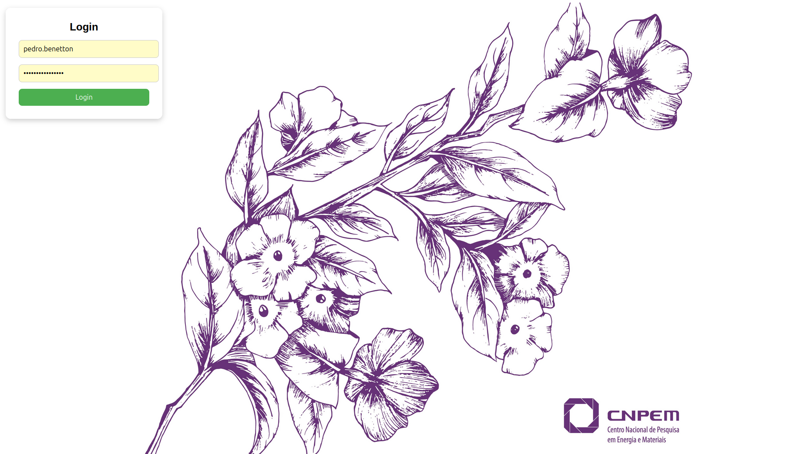
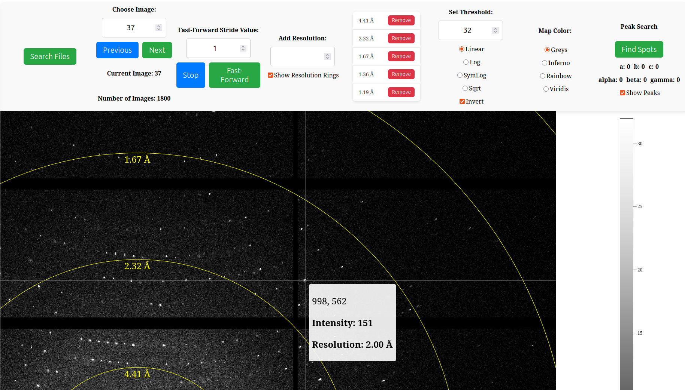

# arara - Analisador de Reflexões de Aquisições de Raios-X

```
git clone https://github.com/cnpem/arara.git
cd arara
mkdir -p app/find_spots/xds
mkdir -p app/keys
# Contact pedro.benetton@lnls.br to obtain your public key, which
# must be placed inside the keys folder
podman-compose up -d
```
Users must login with their CNPEM credentials:


Logged users can access images collected in the MANACÁ beamline
in their proposals:

